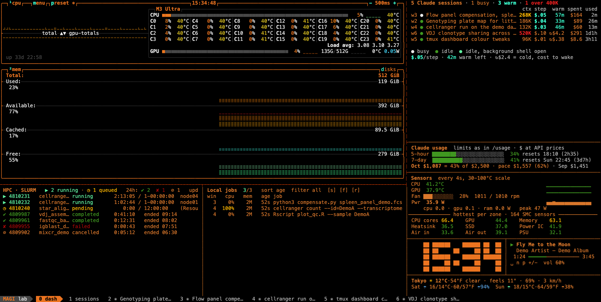
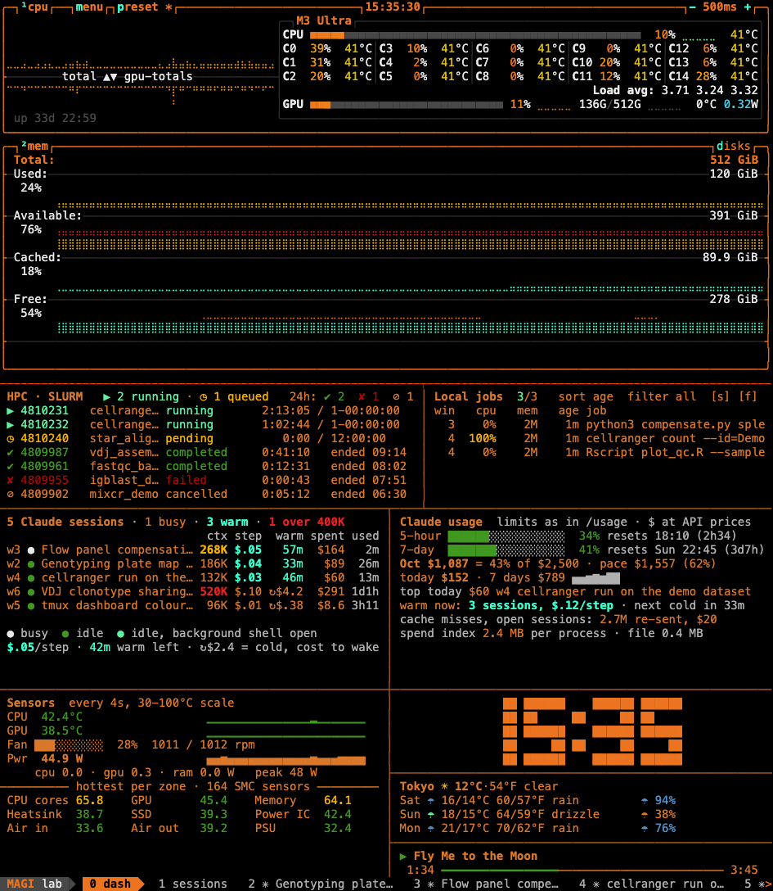
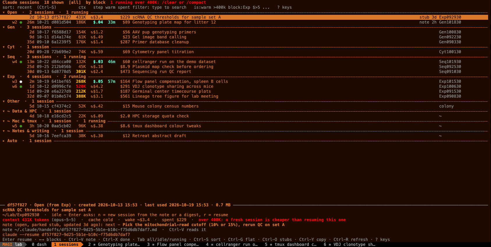

# tmux-dashboard

A tmux dashboard for a Mac that runs many Claude Code sessions.

- **`dash`** (window 0) has nine panes. They show the running sessions and what they cost, plus the SLURM queue, local
  jobs and the machine's load.
- **`sessions`** (window 1) lists every Claude session, so you can resume one or continue its thread in a fresh session.
- **Save / restore** brings the Claude windows back after a reboot.



It was built on one Mac with one SLURM cluster. Everything machine-specific lives in
`~/.config/tmux-dashboard/config`.

- How it works inside: [docs/how-it-works.md](docs/how-it-works.md).
- What changed: [NEWS.md](NEWS.md).
- The screenshots come from a sandbox with made-up data: `demo/make-screenshots`.

## Install

Requirements:

- macOS on Apple Silicon (for `macmon`), Homebrew, Python 3.11+ and tmux.
- Claude Code, for the Claude panes.
- For the SLURM pane, an ssh alias that logs in without a password.

```
git clone git@github.com:tiagobrc/tmux_dashboard_evangelion_theme.git ~/tmux-dashboard
cd ~/tmux-dashboard
./install.sh --check                      # report what is missing, change nothing
./install.sh --brew --theme magi          # install deps, link everything, apply the MAGI theme
$EDITOR ~/.config/tmux-dashboard/config   # SLURM host and user, weather location
tmux new -s main                          # the dash window is added; prefix+g jumps to it
```

`./install.sh` with no flags:

- links `bin/*` into `~/.local/bin` (put it on your `PATH`) and `config/tmux.conf` to `~/.tmux.conf`;
- links the `/handoff` skill into `~/.claude/skills/handoff/`;
- creates `~/.config/tmux-dashboard/config`;
- sets `statusLine` in `~/.claude/settings.json` if none is set, after backing the file up.

It is safe to re-run. It never overwrites a regular file; an existing one is moved to `<name>.bak-<date>`.

| Flag | Does |
|---|---|
| `--brew` | installs tmux, btop, macmon and python from the `Brewfile` |
| `--theme magi\|eva01\|eva02` | fetches the MAGI theme and applies it (see [Themes](#themes)) |
| `--launchd` | installs and starts `dash-web`, the web mirror for the lock screen, at `http://127.0.0.1:8765/` |
| `--check` | dry run |

**Updating.** Run `git pull`; the scripts are symlinks. When new scripts arrive, re-run `./install.sh`, then
`tmux source-file ~/.tmux.conf`.

**Keep your transcripts.** By default Claude Code deletes transcripts after 30 days. A session without its transcript
can no longer be resumed or restored; its spend still counts if the dashboard had read it before. Set
`"cleanupPeriodDays": 365` in `~/.claude/settings.json` to keep a year. `install.sh` leaves this setting alone.

## Keys

| Key | Does |
|---|---|
| `prefix g` | the dashboard (window 0); recreated if you closed it |
| `prefix S` | the session browser (window 1); recreated if you closed it |
| `prefix T` | pin or unpin the current tab |
| `prefix R` | close the gaps in the window numbers |
| `prefix i` | let the pane under the cursor take keys, or stop it (dashboard panes ignore them) |

## The dashboard

| Pane | Shows |
|---|---|
| sessions | the running Claude sessions: context, cost per step, warm cache, spend |
| usage | rate limits, spend at API prices, the size of the spend index |
| slurm | your queue on the cluster and the last 24 h of jobs |
| local jobs | jobs Claude sessions started on this Mac, and the ones that ended in the last 24 h |
| btop | system monitor |
| sensors | power and temperatures |
| clock | the time |
| weather | the forecast from Open-Meteo |
| spotify | what is playing; space, `n`, `p`, `+` and `-` work when the pane is focused |

- **Fits the window.** On every resize the dashboard picks a layout that fits: wide, tall, compact or narrow.
- **Hidden means idle.** The panels and the session browser pause while no tmux client shows them, and catch up
  within ~4 s when you look. The nudge and the budget message still come.
- **Stray keys do nothing.** A key cannot quit btop or pause Spotify. Use `prefix i` to type into one pane.
- **Errors stay contained.** A pane that dies is restarted. A panel error shows one red line; the traceback goes to
  `~/.claude/dash/panels.err`.
- Every new tmux session gets a dash window, unless `TMUX_NO_AUTODASH=1`.
- Money is always in dollars, right-aligned: `$.06 $8.0 $25 $1.7k`.

### Sessions pane

| Column | Meaning |
|---|---|
| `w19` | the window; `0:w19` when it is in another tmux session. A red `×2` means one conversation runs in two windows |
| `●` | bold white: busy; green: idle |
| title | the session's title |
| ctx | the context, in tokens, that every step (each prompt and each tool call) re-sends |
| step | what one more step costs |
| warm | minutes the cache stays warm (bold cyan), or `↻$14`: what the first step costs once it is cold |
| spent | what the session has cost so far |
| used | time since you last used it |

- Busy sessions come first, then warm ones (least time left first), then cold ones (costliest to wake first).
- When the list does not fit, it ends in `… N more · K over 400K hidden`.
- **Nudge.** When an idle session past `CTX_WARN_K` has under `NUDGE_MIN` minutes of warm cache left, a tmux message
  tells you once: continue it now, or `/handoff`. It comes even while the dashboard is hidden.

### Usage pane

- **Limits.** The 5-hour and 7-day rate limits, as `/usage` shows them. `claude-statusline` feeds them, so the status
  line must be set up.
- **Spend.** What the transcripts would cost at API list prices: this month, its pace, last month, today, the last 7
  days and today's costliest session.
- **Budget.** With `MONTH_BUDGET_USD` set, the month shows its share of the budget. The pace turns yellow at 80% of it
  and red at 100%. A tmux message comes once when the month to date passes 80%, and once at 100%.
- **Warm now.** How many sessions have a warm cache, what one more step of all of them costs, and when the next one
  goes cold.
- **Spend index.** The memory that counting spend takes in each process that shows spend (both panels and the browser,
  per dashboard), and the size of its file.
- A short pane keeps the most important lines. A tall one also gets the 7 days as bars.

In a tall window the usage pane has room for every line:



### Local jobs pane

- Columns: `win cpu mem age job`. CPU turns yellow from 50% and red from 400%.
- Keys, after `prefix i`: `s` sorts by age, cpu, mem or session; `f` filters (all, active, long, busy sessions, done);
  `r` resets.
- Finished jobs stay for 24 h. They show when they ended and how long they ran, **but not whether they worked**: a
  job's exit code cannot be seen from outside it.

### SLURM pane

- `squeue` runs every 60 s and `sacct` (the last 24 h) every 5 min, once for all dashboards.
- When ssh or one of the two fails, the pane keeps its last good rows, shows the error, and retries that one after
  30 s.

## Session browser (window 1)



Every Claude session on this Mac, grouped into blocks, with what it would cost to resume. Each row shows the window
and busy dot, when it was last used and created, its id, context, cost per step, warm minutes or wake cost, spend,
title, note age and folder.

| Key | Does |
|---|---|
| type | filter; a search opens every block |
| Enter | resume the session in a new window in its folder, or jump to it if it is running |
| Tab | show all, idle or running sessions |
| Left / Right | previous / next block |
| Enter on a header | fold or unfold the block |
| Ctrl-G | a flat list, without blocks |
| Ctrl-S | sort within blocks: recent, spent, context, wake cost |
| Ctrl-V | view the row's note or digest |
| Ctrl-T | park the thread (see [Threads](#threads)) |
| Ctrl-X | mark the thread done, or reopen it |
| Ctrl-K | end a running session; it asks first |
| Ctrl-Y | copy `claude --resume <id>` |
| Ctrl-O | show stubs: continued and empty sessions |
| Esc / Ctrl-U | clear the filter |
| `?` (filter empty), Ctrl-/, F1 | list every key |

- Ctrl-K ends the session only on `y`, or `Y` if it is busy. Any other key, or 8 s, cancels. The transcript is kept.
- The browser has no quit key, and ignores the mouse and Ctrl-C/Z/D. If it dies, the `pane-died` hook restarts it.

**The context column.**

- `312K $.06 42m`: each step re-sends 312K tokens for 6¢, and the cache stays warm for 42 more minutes.
- `312K $.06 ↻$2.5`: the cache is cold, so the first step after resuming costs $2.50.

| Colour | Means |
|---|---|
| bold cyan | cache warm |
| plain | cache cold |
| yellow | past `CTX_WARN_K` (200K): /compact soon |
| bright red | past `CTX_CLEAR_K` (400K): /clear or /compact now; for an idle session, a fresh one from a note is cheaper |
| dot: bold white / green | busy / idle |

**Filters.** Words combine with these tokens. The search also reads a note's title and its `next:` line.

| Token | Keeps |
|---|---|
| `is:open` `is:warm` `is:cold` `is:running` `is:idle` `is:orphan` | sessions in that state |
| `>400k` `<100k` | context above or below |
| `$>5` `$<1` | spend above or below |
| `block:Exp` | blocks whose name starts with it |

**Blocks.**

- A session's block comes from the experiment code in its folder or title: `Exp011530` goes to Exp, `Gen022830` to
  Gen, and likewise `Cyt…`, `Seq…`, `TC…`.
- The order is Open, then Gen, Cyt, Seq and Exp (`SESSION_BLOCK_ORDER`), other codes by recent use, Other, `~`, and
  Auto last.
- Sessions started in `~` without an experiment code are split by topic, such as `~ Lab work`. The rules live in
  `~/.config/tmux-dashboard/topics`; `claude-session-index --print-topics` gives a starting file.
- **Auto** holds the sessions you did not start by hand: `claude -p` and SDK runs, and anything under
  `~/.claude/tests`.

**In a shell.** `claude-session-index` prints the same table, filtered by any words you give it:
`claude-session-index pcr --idle`. Other options include `--json`, `--block Exp` and `--weekly`.

## Threads

Close a session without losing its task.

1. **`/handoff`** in a session writes a note to `~/.claude/handoffs/<session>.md`. The note has a title, a `next:` line
   (the single next action), and the goal, state, decisions, dead ends, next steps and files.
2. While the note is open, its session sits in the browser's **Open** block at the top, whatever its folder. The
   preview shows the `next:` line. The row shows the note's age (`note 3d`), yellow after 7 days; the oldest note
   comes first.
3. **Enter** on an idle session that has a note, or on a cold one past `CTX_WARN_K`, asks how to continue:
   - `n` starts a fresh session in the same folder, on the same model, from the note. With no note, it starts from a
     digest of the transcript;
   - `r` resumes the session as it is, and shows what waking it costs.
4. **Ctrl-T parks** a cold session without waking it. A stub note appears at once, then `PARK_MODEL` (haiku: ~15 s,
   under 1¢) rewrites it from a digest.
5. **`/handoff done`** or **Ctrl-X** closes the thread. Ctrl-X again reopens it.

- The old session folds under the new one; Ctrl-O shows it.
- When Claude Code purges a transcript, its open note stays, marked "transcript gone"; there Enter offers only `n`.

## Save and restore

- `tmux-claude-save` writes `~/.tmux-claude-restore.sh`, which reopens each window with `claude --resume <id>` in its
  folder. Dated copies go to `~/.tmux-claude-saves/`.
- `tmux-claude-save NAME` saves a named snapshot that restores into a tmux session called NAME. `--list` shows every
  snapshot, its age, and which of its sessions are gone.
- The restore script skips any session that is already running elsewhere or whose transcript is gone, and lists them
  at the end.
- Saving is manual, on purpose. **Do not run a snapshot saved before 2026-10-21 against live sessions:** it lacks this
  check and would resume them twice.

## Tabs and window numbers

- **Pinned tabs** stay at the left of the status bar and never scroll away. `dash` and `sessions` are pinned by their
  launchers; `tmux-pin-tab toggle|on|off|list|defaults` handles the rest.
- **`tmux-claude-renumber`** (`prefix R`) closes the gaps in the window numbers. It keeps `dash` at 0 and `sessions` at 1,
  and moves windows without restarting them. `-n` previews.

## Themes

- `dash-theme magi|eva01|eva02|default` switches tmux, btop, iTerm and VS Code together.
- MAGI turns the dashboard orange; Claude's own windows keep their colours.
- The themes need the MAGI-theme files, which `install.sh --theme` fetches.

## Settings

Settings go in `~/.config/tmux-dashboard/config` as `KEY=VALUE` lines. The template is
`config/dashboard.conf.example`. An environment variable of the same name wins.

| Key | Default | Meaning |
|---|---|---|
| `SLURM_HOST`, `SLURM_USER` | empty | ssh alias of the cluster's login node, and your user there; when empty, the pane says it is not configured |
| `WEATHER_LAT`, `WEATHER_LON`, `WEATHER_PLACE`, `WEATHER_TZ` | NYC, `auto` | where the weather is for; `WEATHER_TZ=auto` takes the time zone from the coordinates |
| `CTX_WARN_K`, `CTX_CLEAR_K` | 200, 400 | context, in thousands of tokens, that turns yellow or red |
| `NUDGE_MIN` | 10 | warm minutes left that trigger the nudge; 0 turns it off |
| `MONTH_BUDGET_USD` | empty | monthly budget at API prices |
| `PARK_MODEL` | haiku | the model that writes a parked thread's note; `off` keeps the stub |
| `WEEKLY_EXPORT_DIR` | empty | where `claude-session-index --weekly` writes `Claude week <YYYY-Www>.md`; empty prints it |
| `SESSION_BLOCK_ORDER` | Gen,Cyt,Seq,Exp | the browser's block order |

## Optional pieces

- **Temperatures.** Put the [iSMC](https://github.com/dkorunic/iSMC) release binary at `~/.local/bin/ismc`. Without it
  the sensors pane shows `macmon` data only.
- **Spotify.** The pane needs the Spotify desktop app; without it, the pane stays idle.
- **Screensaver** (`saver/`): on hold, and not installed (see below).

## Known issues

- **The screensaver goes black** after showing the dashboard for a few seconds. It is on hold; the leading guess is in
  [docs/how-it-works.md](docs/how-it-works.md#screensaver).
- **`tmux-dashboard <session> [index] [-d]`**: `-d` must be the third argument. Put in the index slot, it is read as a
  window offset.

## Repository

| Folder | Holds |
|---|---|
| `bin/` | the scripts, linked into `~/.local/bin` |
| `config/` | `tmux.conf` and the settings template |
| `claude/skills/` | the `/handoff` skill |
| `launchd/` | `dash-web.plist.in`, the web mirror's launch agent; `install.sh` fills in the paths |
| `demo/` | the sandbox that makes the screenshots |
| `docs/` | how it works, and the screenshots |
| `saver/` | the "Tmux Dashboard" screensaver, a WKWebView of `dash-web` (on hold) |
